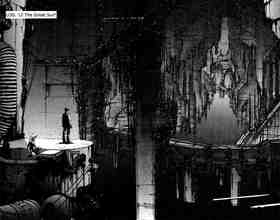
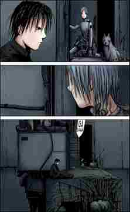
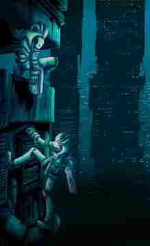
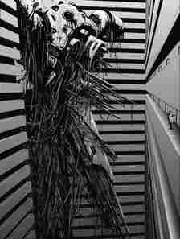

# GRAND GOAL VISION — BLAME! Infinite Megastructure

**Purpose:** this is the project's creative north star for future AI coding agents, world-generation agents, artists, reviewers, and anyone creating screenshots or previews. Read it alongside `AGENTS.md`, `HANDOFF_2026-10-11.md`, and `HANDOFF_BUILD_STATE.md`. The code and verification rules remain authoritative about what currently exists and what is safe to change; this file defines what the experience should ultimately feel like.

## The north star

Build an explorable Minecraft world that feels like a tiny, accidental opening into an almost incomprehensibly large industrial megastructure: ancient, indifferent, hostile, beautiful, functional in ways the player cannot fully understand, and occasionally startlingly quiet.

**The player is not the centre of the world.** Architecture is the protagonist. The player is a scale reference: a small transient silhouette beside structures that dwarf the horizon, continue beyond visibility, and imply further layers above, below, behind, and inside them. The world should feel less like a collection of game levels and more like a fragment of an immense machine-city that has continued to exist long after its purpose has become unknowable.

The emotional target is the tension between three things:
- **Incomprehensible scale:** shafts, walls, towers, bridges, sea-halls, ribs, facades, industrial cavities, and repeated structural patterns extend much farther than the player can comfortably survey.
- **Human fragility:** occasionally, there is a tiny shelter, maintenance bay, abandoned domestic corner, narrow catwalk, or lone light that makes a person feel vulnerable and real.
- **Strange beauty:** severe geometry, cold darkness, fog, water, sparse luminous details, corrosion, and unexpected voids can be beautiful without becoming safe or welcoming.

Do not attempt a panel-by-panel remake of any reference image or reproduce its characters. Use the visual principles below to build an original, coherent procedural environment.

## Reference images

These four user-supplied references are part of the intended visual vocabulary. The pictures are shown inline so an AI inspecting this file can see the source material, not just a description of it.

### 1. The Great Surf — monumental void, industrial coast, human scale

**Take from it:** an enormous, dark, layered cavity; a built edge opening into impossible depth; platforms and pipes in the foreground; distant walls that are too large to comprehend; tiny figures that make the scale legible. The scene is not filled with objects everywhere. Huge regions remain obscure or empty, which makes the visible architecture feel even larger. The silhouette of a human should be a measurement against the structure, not a hero shot.

**World translation:** preserve broad empty spans between important structures, build multi-layer silhouettes, allow ocean/bay edges and industrial terraces to coexist, and make foreground infrastructure lead the eye into a deeper vista.

### 2. Domestic fragments inside infrastructure — claustrophobic human scale

**Take from it:** a tight and somewhat improvised human space pressed against the machine-world. Pipes, ducts, equipment, rough surfaces, a narrow door or recess, and a few personal-scale objects imply that something once lived or worked here. The surrounding architecture remains indifferent. The domestic details matter because they are small and rare.

**World translation:** tiny shelters and ruins can contain bunks, lockers, crates, terminal-like work surfaces, bundled cables, tanks, vents, and patched walls. These should occupy a small part of a vast district, not turn the whole megastructure into a normal town. Keep the spaces cramped, awkward, utilitarian, and believable.

### 3. Cyan verticality — perilous height and sparse luminous detail

**Take from it:** a sheer vertical drop, dense near-field infrastructure, distant black towers, a cold cyan glow, and tiny attached figures/platforms. The luminous colour gives depth to darkness rather than filling every surface with neon. The structures feel exposed, vertically continuous, and dangerous to traverse.

**World translation:** use rare cyan/blue-green illumination, lit apertures, distant point-lights, exposed bridges and wall-mounted service routes. The viewer should understand that falling or becoming lost would matter. Keep large surfaces dark enough for the small lights to read.

### 4. Machine against a corridor — scale contrast and mechanical density

**Take from it:** an immense piece of equipment jammed into a space that is already enormous; cable bundles, pipes, structural rails, repeated horizontal bands, and a minuscule observer create scale and unease. The machine is not clean or showroom-like. Its silhouette has irregular protrusions and accumulated infrastructure.

**World translation:** create occasional machine halls, tank clusters, pipe forests, cranes, server-vault-like masses, incomplete frames, abandoned transit lines, and wall mechanisms. Vary the silhouette and density, but make each assembly appear to have a physical purpose. Avoid decorative clutter that has no structural logic.

## Art direction rules

### Scale must be readable at multiple distances

Every major vista should have at least three readable depth layers when possible:
1. **Near:** a ledge, handrail, pipe, concrete lip, broken deck, ladder, machine casing, or small ruin that the player could stand beside.
2. **Middle:** a traversable bridge, wall rib, tower, arch, gate, pipe bundle, platform stack, or machinery mass.
3. **Far:** a structure too large to inspect fully, cut by haze/darkness, continuing beyond the frame or into a deeper cavity.

Use small repeated structural details against very large forms. Make stairways and walkways implausibly long. Let a surface disappear upward or downward rather than presenting every structure as a complete object with a readable top. Do not rely on height numbers alone; the composition must *look* vast from the player’s point of view.

### Alternate compression and emptiness

The world needs rhythm. Do not fill every cube or every vista with structures.

- **Compressed:** narrow service passages, low rooms, maintenance voids, pipe-packed walls, awkward doorways, bundled wiring, and cramped shelter interiors.
- **Monumental:** vertical shafts, open bays, transit cavities, enormous wall surfaces, distant towers, hanging bridges, and lightless drops.
- **Sparse:** a nearly bare platform, an abandoned corridor, a vast floor with one machine, a quiet ocean edge, a broken bridge leading nowhere, or a lonely lamp in a huge wall.

Long intervals of relative emptiness are essential. They make the next structure feel more consequential. Noise, debris, pipes, lights, and landmarks all need negative space around them.

### Architecture before decoration

Start with volumes, support logic, access paths, structure thickness, rhythm, and silhouette. A vista should remain compelling as a flat black silhouette. Only then add seams, grilles, braces, cables, vents, lamps, rust, damaged edges, and small artifacts.

Forms can be rationalist, octagonal, leaning, arcaded, fractured, or organic, but they should share a severe material language and feel like pieces of the same industrial world. Impossible size is welcome; arbitrary geometry without visual logic is not.

### Palette and light

The default world is cold, low-saturation, and high-contrast:
- charcoal, black, ash grey, pale concrete, old metal, smoked glass, deep water, and dusty stone;
- restrained rust, oxidized copper, weathered green patina, and muted mineral variation;
- rare cyan or blue-green lights as depth cues;
- occasional pale white lamps or distant specks to show immense distance.

Avoid a uniformly bright sci-fi city, rainbow accents, saturated fantasy biomes, and evenly lit corridors. A dark area should not always become a featureless black void: use silhouette edges, shafts of ambient light, sparse lamps, distant specks, or a lit opening to preserve spatial comprehension. Dark architecture and luminous points should reinforce one another.

### Abandonment and habitation

The world should ordinarily feel empty of crowds. Human evidence is expressed through traces: a shelter, a tool-sized alcove, a terminal, a crate, a bedroll/bunk, a patched doorway, a service ladder, a maintenance platform, or a single light still functioning. Such details should be rare enough that finding one feels meaningful.

Keep the existing no-mob/quiet-world direction unless an explicit future task says otherwise. Do not solve atmosphere by adding large populations of entities. Minecraft block geometry, architecture, light, sound design proposals, and spatial composition should carry the mood.

## Translate the vision into this codebase

The surrounding world is a procedural, deterministic generator for Minecraft 1.12.2 and CubicChunks. Toha Heavy Industries is the deliberate exception: a hand-authored, seed-invariant cylindrical megastructure that must remain a single coherent architectural composition.

- Treat `mod/src/main/java/blame/blamegen/core/` as pure Java. **Never add Minecraft or Forge imports to `core/`.**
- Use `Mat.java` and `Styles.java` for material identity/style choices; use the existing `Cube` primitives and add new primitives only where they solve a real geometry need.
- Use `Megastructure.java`, `Arrival.java`, `Face.java`, and `Landmark.java` as the organisation of the surrounding world. Inspect implementations before extending them; do not re-create systems that already exist.
- `Toha.java` is the fixed monumental set piece. Preserve its exact bounds and hand-authored design; do not turn it back into procedural district generation.
- Geometry must be derived deterministically from seed and coordinates. Do not use runtime time, `Math.random()`, non-deterministic collection iteration, or state that makes cube-generation order matter.
- Every feature must stay inside its owner region. Current documented margins are `MARGIN_XZ = 72` and `MARGIN_Y = 56`; if a feature crosses them, update margins and `tools/verify/SeamCheck.java`.
- Keep primitives cheap by rejecting outside bounding boxes before raster work. Existing baseline was roughly 0.3 ms/random cube and about 0.55 ms/arrival cube; benchmark changes rather than assuming them harmless.
- If architectural form changes, bump `Megastructure.GENERATOR_VERSION`, update previews under `docs/previews-<next>/`, run offline verification, and update the dated handoff.
- Treat all runtime claims as unverified until they are actually tested. An offline preview is not an in-game screenshot; a source patch is not a built JAR.

## Toha Heavy Industries — authored monument contract

Toha is a **single fixed landmark**, not a randomized district. Generator v21 replaces the previous overly wide drum with a narrow, tapered industrial spire rising through a vast engineered valley inside the greater megastructure, and adds a second level of machinery: twelve elevated process pods docked to six bridge tiers. Its authored geometry lives in `mod/src/main/java/blame/blamegen/core/Toha.java`: an 1,966-block-tall hollow spire, an eccentric hollow gravity furnace, thirteen staggered AI-controlled machine chambers, broken orbital decks, a helical maintenance path, a broad canyon bounded by high stratified walls, seven levels of cliff-side catwalks, north/south service portals, cross-valley bridges, cargo tracks, conveyors, transfer gantries, and a network of fixed machine yards, twenty ground-level machine modules, paired cargo-rail corridors, raised conveyors, loading gantries, and twelve elevated processing pods. The coordinates are deterministic and seed-invariant.

Keep the silhouette unmistakable at a distance: a single thin dark spike that narrows towards the roof, framed by a canyon many times wider than the tower. The valley should feel like a cut through an older structure—not an open circular plaza around a freestanding building. Show layered wall strata, tall support ribs, immense recessed bays, incomplete service ledges, suspended bridges and a few routes that disappear into the walls. Avoid making Toha a thick tower, a tidy stepped wedding cake, a generic sci-fi city, or an evenly tiled apartment facade. Preserve the quiet black-and-ash palette, pale structural cuts, oxidized-metal accents and rare cold cyan status lights.

Populate the immediate environment with **functional-looking industrial connections**: slab and stair landings, half-height slabs, rails, trapdoors, ladders, dispensers, hoppers, piston-driven rotor frames, tanks, pipes, ventilation ducts, suspended cargo trays, gantries, cable bundles and maintenance bridges. Detail should cluster around routes and equipment yards, leaving some long spans of open canyon so the scale reads clearly. Each machine should sit on a footing, connect to a conduit or route, attach to a wall, or hang from an evident frame. Use authored, non-mirrored placements rather than random prop scattering.

The thirteen AI chambers are fixed openings that shrink with the spire. Each has an actual void cut through the shell, a recessed control face and coordinate-authored machinery. Their positions must avoid the gravity furnace and service paths, and the surrounding platforms must connect to the cliff network. Preserve hollow interior volumes, accessible approaches and an uninterrupted visual hierarchy from the valley gate to the spire crown. Only material weathering may vary by seed. See `docs/TOHA_MONUMENT_DESIGN.md` for the current layout and verification contract.

## How an AI agent should work

1. Read `AGENTS.md`, this file, `HANDOFF_2026-10-11.md`, and `HANDOFF_BUILD_STATE.md` before making substantial changes.
2. Identify the current working blocker and the last known verified state. Do not blindly trust old packaged JARs: the handoff explicitly warns against mixing the v1 adapter with the v3/v4 material table.
3. Make a small, coherent change that advances the build or the visual target. Prefer a concrete new spatial idea over broad random clutter.
4. Run the available offline compile and checks: `Probe`, `SeamCheck`, `Survey`, `LandmarkSurvey`, and `Preview bench 3000`. For visual changes, render and inspect a preview.
5. If a Minecraft/Gradle build cannot run, state the exact failure stage and error; do not report success. Keep source changes isolated and reviewable.
6. Record what changed, what was tested, what was not tested, and the next actionable step in the handoff.

## Success criteria

A strong result should let someone see one image and believe all of the following:
- the world is far larger than the explored fragment;
- giant architecture is structurally varied rather than a repeated box pattern;
- a human could travel through it, but would feel tiny, exposed, and insignificant;
- there are places so tight and cluttered that they contrast with vast open voids;
- darkness is deliberate and punctuated by distant or localized light;
- industrial details imply function, history, abandonment, and danger;
- the beauty comes from scale, silhouette, material, light, and emptiness—not from filling every space.

The goal is not “the most blocks” or “the most structures.” The goal is a world with **unforgettable scale, believable industrial logic, human vulnerability, oppressive quiet, and strange beauty**.

## Reusable instruction for the next AI

> Continue the existing BLAME Megastructure project; do not restart or replace its architecture. Read `AGENTS.md`, `GRAND_GOAL_VISION.md`, `HANDOFF_2026-10-11.md`, and `HANDOFF_BUILD_STATE.md`. The grand goal is a deterministic, explorable industrial megastructure that alternates tiny cramped human spaces with vast, hostile, beautiful voids. Use the embedded reference pictures for scale, darkness, cyan accents, machine density, and traces of habitation—not for panel-by-panel copying. Preserve the pure-Java generator core, deterministic seed/coordinate geometry, seam containment, and performance. First address the actual build blocker; then compile the mod, test world creation in Minecraft 1.12.2/CubicChunks, and record verifiable results. Never claim a build or in-game test passed unless it did.
